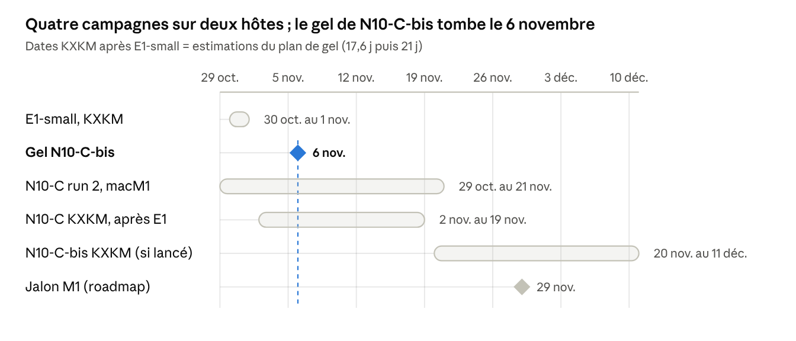
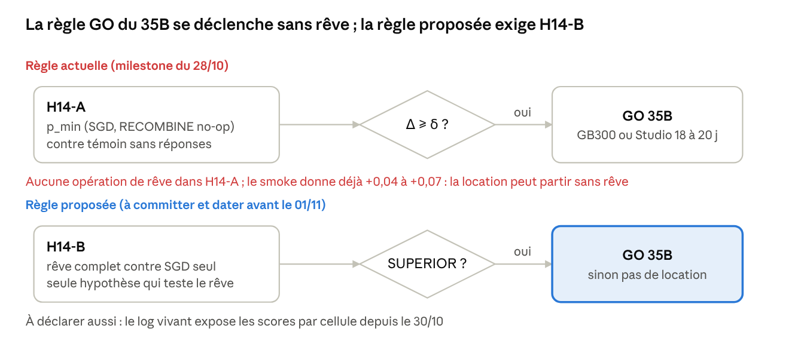
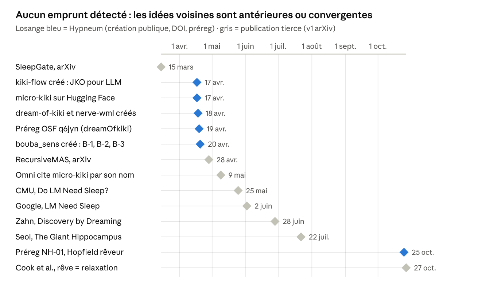
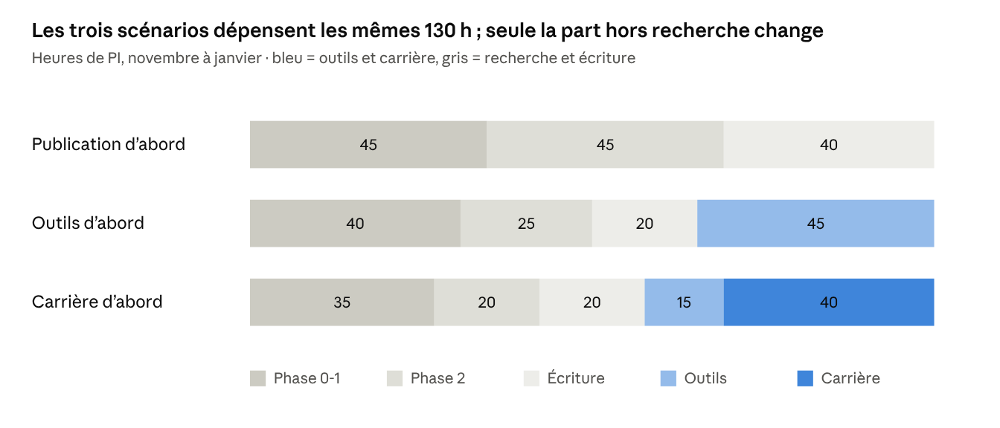
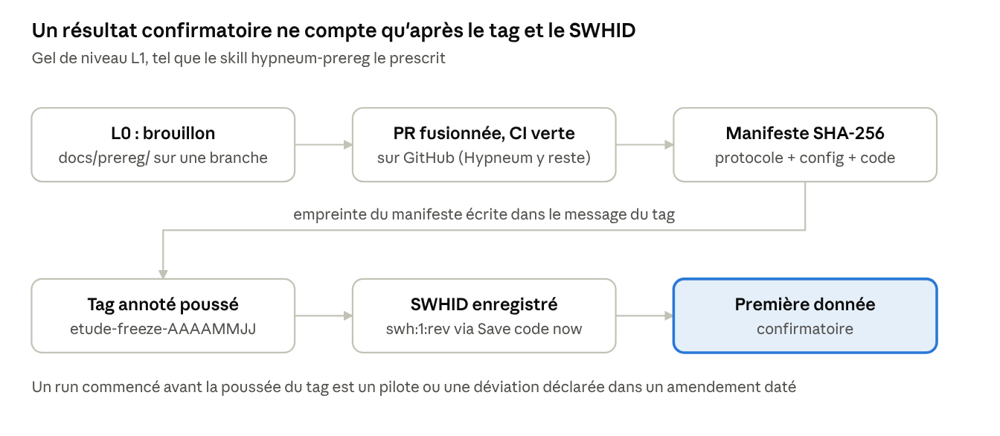

# Hypneum Lab — état des lieux, 30 octobre 2026

30 octobre 2026 · Clément Saillant (PI) · état des lieux produit avec Claude Code et Codex CLI, vérifié source par source

> Version Markdown du Claude Doc « Hypneum Lab — état des lieux, 30 octobre 2026 ». Les figures sont des captures des schémas interactifs du doc. Annexes dans ce dossier : `inventaires/` (état par dépôt + relevé de calcul), `veille/` (littérature R1–R5 et R6–R11, paysage open source, utilité, enquête réutilisation), `synthese/` (relecture, priorités et hypothèses), `codex/` (brief, rapport gpt-6.1-sol, vérification).

## Résumé exécutif

**État.** Sept dépôts scientifiques, quatre campagnes en cours le 30/10 (E1-small sur KXKM jusqu'au 01/11 au soir, N10-C run 2 sur macM1 jusqu'au 20–21/11, NH-01 reruns sur electron-server, NH-81 et la grille M5 sur macM3), 65 issues ouvertes « à valider PI », une roadmap qui demande environ deux fois les 10 h hebdomadaires disponibles.

**Relecture.** Sept constats bloquants et cinq majeurs. La discipline de gel (tags annotés, SHA des manifestes, déviations déclarées) est réelle et vérifiable ; ce qui manque dans cinq dépôts sur six est la validité des manipulations et des mesures : la règle GO du 35B se déclenche sur une hypothèse sans rêve ; la lésion B-3 n'a jamais été appliquée (SNR 19 dB) ; la tâche N10-C ne requiert pas de communication ; le DOI Zenodo kiki-flow publie un pas non JKO sous le nom « rigorous » ; le profil public affiche encore des chiffres retirés ; M5 est en échec mécanique par couverture ; le brouillon TOST est piloté dans un régime qui n'apprend pas. Seize affirmations des notes antérieures sont contredites par les dépôts.

**Calcul.** Deux anomalies à signaler avant toute action : la seule copie des runs N10-C n°2 est sur macM1 et le cron de synchronisation lit encore l'ancien dossier ; le log vivant d'E1-small expose des scores par cellule alors que la règle GO promettait de ne rien voir. Aucune intervention n'a été faite.

**Littérature et open source.** 52 nouvelles références R1–R5 et une veille R6–R11, toutes résolues ; cinq risques de scoop (« When to Sleep » pour NH-03, Agliari pour `recombine`, Latent Telepathy pour N10-C, résultats négatifs développementaux pour baby-brain, « sommeil » saturé par Google et CMU). Exposition publique d'Hypneum quasi nulle (4 étoiles, 0 téléchargement HF, 57 téléchargements Zenodo au mieux) : le risque vient de travaux indépendants, pas de copies. NH-20 (splitting Lie/Strang d'un flot WFR) et la cécité congénitale contre tardive restent libres.

**Priorités.** Dix actions pour environ 21 h de PI, dont quatre avant le 01/11 : dater la règle GO réduite à H14-B, porte de nécessité dans le texte N10-C-bis avant le gel du 06/11, retirer les chiffres retirés du profil, amender M5 avant toute donnée γ ≤ 30. Pauses recommandées : E1 35B, M5 secondaire, NH-81 r5, #90, v0.9/TOST. Onze hypothèses nouvelles NH-91 à NH-101, cinq pistes inventives dont le jeu de données d'errata comme meilleure chance de publication. Désaccord interne sur l'axe matière : GO restreint à 15 h contre NO-GO par défaut.

**Utilité.** Cinq négatifs publiables avec artefact ; deux outils extractibles (`jpt` J/token, `prereg-guard`) ; une note méthodo comme premier publiable ; recommandation d'un mélange carrière + publication à 130 h.

**Skills et seconde relecture.** Sept skills Hypneum créés et testés (RED/GREEN), ship-critic étendu avec Codex en second relecteur et le périmètre `prereg`. Le passage en aveugle de Codex gpt-6.1-sol a été vérifié source par source : 5/5 bloquants et 11/13 majeurs confirmés, 9 constats nouveaux retenus (dont la borne de Holevo mal appliquée dans micro-kiki-quantum et la covariance de graine omise dans l'analyse N10-C), 2 désaccords tranchés en faveur de notre lecture (B-3, C3′) et 2 de nos constats corrigés (10 et 12). L'enquête réutilisation/plagiat est rapportée dans la section Littérature.

**Comment lire ce rapport.** Chaque section part des dépôts tels qu'ils sont le 30/10, cite un fichier et une ligne pour chaque constat, et sépare ce qui est un fait (F), un jugement calculé ici (J) et une supposition (S). Quelques termes reviennent partout :

- **BLOQUANT / MAJEUR / MINEUR** : un bloquant interdit de publier, geler ou dépenser tant qu'il n'est pas corrigé ou explicitement borné ; un majeur change l'interprétation d'un résultat ; un mineur se corrige en passant.
- **Préregistration et gel (L0 à L3)** : écrire le protocole et la règle de décision avant les données, puis le dater de façon vérifiable (tag Git annoté, archive Software Heritage, dépôt OSF). Un run commencé avant le gel est un pilote, pas une confirmation.
- **Nul calibré ou apparié** : la distribution qu'on obtiendrait sans effet, calculée avec exactement le même dispositif (mêmes graines, même maximum pris sur les mêmes cellules). Sans lui, un seuil fixé à la main (« 0,02 ») est franchi par le hasard seul.
- **Contrôle tautologique** : un témoin qui ne peut pas échouer, par construction ou par théorème ; il confirme toujours et n'apprend donc rien.
- **Porte de nécessité** : avant de mesurer si un canal de communication aide, vérifier que la tâche échoue sans lui ; sinon le canal ne peut rien montrer.
- **Puissance au N enregistré** : la probabilité de détecter l'effet attendu avec le nombre de graines prévu ; sous 0,5, un résultat nul ne dit rien.
- **Convergence contre emprunt** (section réutilisation) : même idée trouvée indépendamment, contre copie de code ou de texte ; seule la seconde constitue une preuve.

## État des lieux par dépôt

Depuis la revue du 24/10, 274 commits sur six dépôts, quatre campagnes de calcul en cours, aucun résultat confirmatoire lisible avant le 1er novembre. Relevé des hôtes à 14:22 CET, lecture seule.

| Dépôt | Fait depuis le 24/10 | Calcul en cours (hôte) | Bloqué / décision PI |
| --- | --- | --- | --- |
| nerve-wml (HEAD 99a7cf4) | N10-C : effondrement du tronc IMPALA diagnostiqué, correctif C (PR #72), nouveau gel `n10c-freeze-20261029` + Software Heritage ; N10-C-bis 4 bras (PR #80) ; NH-01 Hopfield rêveur ratio 3,43 (PR #81) | N10-C run 2 macM1 : `registered-gtm-s0` fini (50 M pas, 18,1 h, succès 0,96), `closed-gtm-s0` à 36 M/50 M, fin \~19:30 ; NH-01 reruns electron-server (lancés 13:10) | KXKM attend la fin d'E1-small ; PR #86/#87/#90 NH-01 en brouillon ; aucun `run.json` de la campagne 2 dans le dépôt |
| dream-of-kiki (HEAD 6a61e80) | E1 core + E1-small (PR #72, lock 963bb24), filing re-pin #73, G4 + DR-3 packages #74, règle GO/NO-GO 35B #75, NH-03 (#69/#70) | E1-small confirmatoire KXKM : 290/1 410 cellules à \~177 s, fin \~01/11 21:30, GPU 21,9/24,5 Go | Dépôt OSF E1-small/G4/DR-3 (PI) ; PR #79 préreg NH-03 ; PR #41 (35B) ouverte ; règle GO 35B à réviser avant la fin du run |
| bouba\_sens (HEAD 1290a4b) | Calibration du nul Me6 (#19), ADR-0022, grille gaussienne 150 cellules (p = 0,17), v0.8 retirée, v0.9 rev B/C/D échouent la gate, S00 ActionSense run 2 | aucun (nuls Me6 sur KXKM : non lancés, introuvables) | PR #55 amendement v0.7 (signature PI), PR #9 préregs TOST, issue #52, PR #56 |
| kiki-flow-research (HEAD 31feab6) | Pas « rigoureux » identifié non-JKO (#40), nouveau pas JKO entropique (#45–#47), pas implicite certifié (#51), paper v0.13 Zenodo + erratum | M5 certify : arrêté sur ES (13 configs), 37 configs γ 20–100 attendent la fin de NH-81 sur macM3 | PR #52 règle M5 (brouillon) ; ERRATUM §16 toujours PROPOSED ; issues #29/#32 périmées |
| micro-kiki (HEAD 3a3a5ba) | NH-81 énergie : 6 tags, 3 tentatives KXKM refusées (PR #19), préreg M3 Pro taguée | NH-81 mesure sur macM3 (61 lignes W2, machine redémarrée il y a 40 min) | Scripts d'attente abandonnent le 04/11 12:00 ; C5 à abandonner |
| baby-brain (HEAD 6eb0a74) | Phase 0 docs (#289), 3 commits | aucun | #288 (nouveau critère LP) ; verdict « 1b réfuté » à requalifier |
| .github + Project | Roadmap + gestion de projet (PR #4), 80 items dans le projet | — | 65 issues encore `a-valider-pi` (pas 47) ; M0 du 8 nov : 12/18 fermées, 6 restantes tenables en une soirée ; profil public affiche encore 70,7 % / 89,5 % |

*relevé de calcul du 30/10 14:22 CET + plan de gel N10-C du 28/10 · dates KXKM estimées*

**Comment lire ce calendrier.** Chaque barre est une campagne de calcul sur une machine, chaque losange une date qui engage. E1-small occupe la seule carte graphique (KXKM) jusqu'au 1er novembre au soir ; rien d'autre ne peut y tourner avant. N10-C run 2 tourne sur le Mac M1 jusque vers le 20 novembre ; c'est la seule copie de ces runs tant que la synchronisation n'est pas réparée. Le trait pointillé marque le gel de N10-C-bis (6 novembre) : tout ce qui doit changer dans le protocole bis (porte de nécessité de la communication, déclaration de la brèche d'aveuglement) doit être écrit et fusionné avant ce trait. Les deux barres KXKM après E1 sont des estimations du plan de gel, pas des runs lancés : elles montrent que le jalon M1 du 29 novembre tombe au milieu de N10-C KXKM et que bis ne finirait qu'à la mi-décembre.

Studio ne porte plus rien pour Hypneum. macM1 : T7 303 Gi libres, téléchargement ActionSense S02–S05 en cours (44 G), lock heavy et pause du modèle de jour cohérents.

## Relecture : constats bloquants et majeurs

Sept constats bloquants et cinq majeurs, dédoublonnés entre les six inventaires. Le motif commun à cinq dépôts sur six : la discipline de gel (tags, SHA, déviations déclarées) est réelle et vérifiable, mais la validité des manipulations et des mesures manque, et chaque nouveau gel fige ce défaut au lieu de le corriger. Croisement avec le passage en aveugle de Codex (gpt-6.1-sol) en fin de section.

*motif commun de la relecture · 4 garanties en place, 5 défauts de validité*

**Comment lire ce schéma.** La bande du haut est ce qui marche : le protocole est figé avant les données, et on peut le prouver à un tiers (tag daté, empreinte du manifeste, archive Software Heritage, écarts écrits noir sur blanc). La bande du bas est ce qui manque : dans cinq chantiers, l'expérience ne teste pas ce qu'elle croit tester, parce que la manipulation n'a pas d'effet (lésion), que la tâche se résout sans le mécanisme étudié (communication), que le contrôle ne peut pas échouer (NH-01), que la mesure est sous le hasard (E1) ou que la comparaison est gagnée d'avance (NH-81). La flèche dit le danger : geler un protocole dont la mesure est invalide ne fait que rendre l'erreur irréversible et datée.

| # | Dépôt | Constat | Preuve | Conséquence | Action ≤ 1 soirée |
| --- | --- | --- | --- | --- | --- |
| 1 | dream-of-kiki | BLOQUANT. La règle GO du 35B se déclenche sur H14-A, qui compare `p_min` (SGD, RECOMBINE no-op) à un témoin sans réponses : aucune opération de rêve. Smoke déjà +0,037 à +0,067. Le log vivant affiche des scores par cellule. | `docs/milestones/e1-35b-go-rule-2026-10-28.md:43-44` ; `docs/osf-prereg-e1-small-2026-10-25.md:140-154` | Location GB300 ou 18–20 j de Studio déclenchables sans rêve ; la règle promettait « not changed after any E1-small number is seen » | Committer ce soir GO = H14-B SUPERIOR seul, daté, et déclarer l'exposition du log |
| 2 | bouba\_sens | BLOQUANT. Aucune grille B-3 depuis le 24/10 ne passe `--k-steps` ; avec k = 5 000 le SNR reste à 19,2 dB et la diagonale lésée n'est pas dégradée (0,660 vs 0,66). PR #55 reproduit le défaut sur 600 cellules. | `scripts/run_grid_probe_v2.sh:73-76` ; `cli.py:388` ; `reports/b3_lesion_interaction_gaussian.json` ; `README.md:60` | « Aucun effet de lésion » non soutenu ; même défaut que B-1 noté le 24/10 | README → « non concluant, lésion non effective » ; `K_STEPS` sur main ; ne pas signer #55 |
| 3 | nerve-wml | BLOQUANT (construit). Succès d'équipe ≈ taux de pièce individuel (0,94–0,97) ; le bras à messages permutés `gtm_mis` atteint 0,81 > `gtm` (0,54–0,73) ; une politique scriptée sans message fait 43 %. | `amendment-2026-10-25.md:32,141-153` ; `n10c-bis-control-arms.md:302` ; `coop_env.py:11-13` | Contrastes θ et NI ≈ 0 ; ≈ 950 h engagées + 21 j KXKM pour bis | Porte de nécessité (`eng − nocomm ≥ 0,2`) dans le texte bis avant gel ; N10-C = borne sur une tâche sans besoin d'information |
| 4 | kiki-flow | BLOQUANT (diffusion). Le DOI Zenodo 23636477 (tag `paper-v0.13-draft`) publie le split non JKO sous le nom « rigorous JKO path », sans ERRATUM §11–16 ; `main.tex` périmé. | `CITATION.cff:37-38` ; `paper/main.tex:20-34,340-345,466-497,578` | Toute citation externe propage un résultat retiré | Note Zenodo « superseded » + bannière en tête du .tex |
| 5 | .github | BLOQUANT (public). Le profil affiche encore top-1 70,7 % / top-3 89,5 %, retirés le 25/10 (46,4 % mesuré). | `.github/profile/README.md:54` ; `micro-kiki/docs/ERRATA.md` E-03 | Page la plus vue ; M0 ne peut pas être tenu | Supprimer la ligne |
| 6 | kiki-flow | BLOQUANT (verdict M5). 96 configurations prévues, une absente = non certifiée ; 13 (ES) + 37 (macM3) = 50 ; rien pour γ ∈ {0, 5, 10} ; `RUN_KEY` sans hôte alors que les trajectoires diffèrent jusqu'à 5e-3 entre machines. | `docs/prereg/2026-10-30-m5-certify-reading-rule.md:56-58` ; `implicit_jko_certified_validation_2026_10_27.py:135-141` | Verdict `failed` mécanique | Amender (hôte, 46 configurations restantes, doublons) via PR #52 avant toute donnée γ ≤ 30 |
| 7 | bouba\_sens | BLOQUANT (dépôt). Brouillon TOST (PR #9) piloté dans le régime qui n'apprend pas ; passage à Hodges–Lehmann décidé quand la queue « switch » rend la TOST impossible ; test de signe équivalent dans 77 % des cas à la borne. | `PR9:docs/osf/amendment-v0.7-tost-equivalence-2026-10-23.md` ; `v07_sign_power_r4_n150.json` ; ADR-0024:65-66 | Équivalence acquise d'avance sur un canal effondré | Geler le texte ; publier B-1/B-2 comme nuls d'un régime non apprenant |
| 8 | nerve-wml (calcul) | MAJEUR. `registered-gtm-s0` entraîné mais `eval_done=false`, `archived=false`, `synced=false` ; le cron lit `n10c-run` (campagne 1), pas `n10c-run2` ; l'archive ES ne contient que 2 runs exclus ; SWHID du tag 29/10 absent du dépôt. | relevé §2–3 ; `campaign/README.md:178` | Seule copie des runs n°2 sur macM1, machine bloquée du 26 au 28/10 | Repointer le cron, vérifier un pull ES, committer le SWHID (visite 2588832) |
| 9 | nerve-wml | MAJEUR (aveuglement). Le texte bis interdit de lire toute courbe N10-C avant son tag ; les notes citent « succès final 0,96 ». | `n10c-bis-control-arms.md:42` | Seconde brèche non déclarée | La déclarer dans le texte bis avant son tag |
| 10 | nerve-wml (NH-01) | MAJEUR. À T = 0,2, c(t) < 1 par construction donc C3′ ≤ 1 par théorème : le contrôle ne peut pas réfuter ; #87 « 44,4× » sur un dénominateur interpolé avec graines retirées. | `nh01…downscale.md:26-27` ; `confirmatory-n1000.md:19,40,47` | « Confirmé » = réplication de la projection régularisée (Kanter–Sompolinsky 1987, Fachechi 2019) | #87 → non calculable ; fermer #90 ; contrôle non uniforme en préreg |
| 11 | dream-of-kiki (E1) | MAJEUR (mesure). Daily Oracle 0,185 (hasard 0,25) ; la bonne réponse est la plus longue dans 34 % des cas ; DOWNSCALE ×0,99 pèse \~35× la mise à jour SGD ; aucune sonde d'oubli. | `corpus-manifest-frozen-2026-10-28.json` ; `pilot_cycle3_cuda.py:282-291,463-466` | Tout Δ peut venir d'artefacts de rédaction ; E1 ne mesure pas la consolidation | Contrôle « options seules » sur le modèle de base, après le run ; lire par source |
| 12 | micro-kiki (NH-81) | MAJEUR. Voie « fused » = dense + boucle LIF, donc R ≤ 1 quasi par construction ; effet d'ordre 0,82 vs 1,01, plus grand que la demi-largeur de l'IC \[0,83 ; 1,01\]. | `nh81-joules-per-token.md:97-100` ; `2026-10-25-nh81-joules.md:82-85` | Faible information, coût de pilotage élevé (prévu S8) | Ordre en covariable ; pas de r5 ; clore « withdraw, provisional » |

*constat 1 · dream-of-kiki, règle GO du 28/10 contre règle proposée*

**Comment lire ce schéma.** E1-small teste plusieurs hypothèses sur le petit modèle 4B. H14-A compare une variante où la recombinaison est désactivée à un témoin qui n'a jamais vu les réponses : c'est un test d'apprentissage ordinaire, sans aucune opération de rêve, et les essais préliminaires le donnent déjà positif. Or la règle écrite le 28 octobre déclenche la dépense la plus lourde du programme (location d'un GB300 ou trois semaines de Studio pour le 35B) dès que H14-A passe. La règle proposée ne retient que H14-B, la seule hypothèse où le rêve complet est comparé à l'apprentissage seul. Elle doit être committée et datée avant la fin du run (1er novembre), sinon elle serait écrite après avoir vu les chiffres.

Majeurs de second rang : G4 lisible dès le smoke 3 (A ≈ +0,005, unmixed ≥ cross, DOA figé à 0,5) ; FAILS H13-C/D de DR-3 garantis par τ et la normalisation (`relational_probe.py:167-179`) ; PR kiki-flow #45/#48/#50 fusionnées en 9–54 min sans revue ; blocage de grille possible à 16 points ; sondes ActionSense dégénérées sans séparation train/test ; baby-brain « 1b refuted » → critère non valide ; délai NH-03 (#79) qui confond récence et interférence. Contradictions entre inventaires tranchées par le relevé : KXKM ne porte aucun N10-C (E1-small tient le GPU) ; macM3 est joignable mais absent de `~/CLAUDE.md` ; fin d'E1-small le 01/11 vers 21:30.

### Croisement avec Codex gpt-6.1-sol (passage en aveugle)

Codex a relu les dépôts sans voir nos conclusions et rendu 5 bloquants et 13 majeurs, tous numérotés puis vérifiés fichier par fichier (annexe `codex/verification-sol.md`). Bilan : 5/5 bloquants confirmés ; 11/13 majeurs confirmés, 2 nuancés (E1 : l'OPR choisit l'argmax du checkpoint pré-replay, pas de la base, `e1_harness.py:242` ; kiki-flow : facteur ½ manquant confirmé, hook T2 non retrouvé à `paper_run.py:251`). Nos 12 constats vus par Codex : trouvés indépendamment 10 et 12 ; partiellement 2, 3, 6, 7, 11 ; non trouvés 1, 4, 5, 8, 9 (la règle GO 35B, le DOI Zenodo, le profil public, la synchronisation et l'aveuglement N10-C sont donc des apports de cette session).

**Neuf constats nouveaux de Codex, confirmés en source.** Deux montent au rang majeur : micro-kiki-quantum, borne de Holevo mal appliquée (`c5-info-bound.tex:27-30` borne à N bits alors que le simulateur calcule des espérances exactes, `torch_vqc.py:143-150` ; l'erratum E-2026-10-25-02 corrige l'estimateur, pas le principe) ; N10-C, covariance omise (tous les bras d'une graine partent du même tronc, `amendment-2026-10-25.md:61`, mais l'analyse reste Welch sur groupes indépendants). Les sept autres : B-3, le seuil 0,02 est franchi dans 100 % des nuls (`adr/0021:138-145`) ; kiki-flow, facteur ½ absent du code (`paper_f.py:104` contre `main.tex:186`) et étape de dérive qui clippe puis renormalise ; LoRA, porte en AND qui accepte n'importe quelle perte si l'angle est grand ; micro-kiki-quantum, entraînement et évaluation sur les mêmes données ; NH-01, le critère C2 laisse passer deux baisses cumulées ; Studyforrest non reproductible ; baby-brain, Mann–Whitney sur série autocorrélée et règle « IC chevauchants = falsifié ».

**Désaccords tranchés.** Codex classe le B-3 final « OK » (p = 0,494) : notre constat 2 tient, car la grille préenregistrée passe par `run_grid_probe_v2.sh` qui ne transmet pas `--k-steps`, le défaut vaut k = 5 000 (SNR 19,2 dB, `adr/0020:28-34`) et la diagonale lésée n'est pas dégradée. Codex rate aussi qu'à T = 0,2 le contrôle C3′ ne peut pas réfuter. En sens inverse, deux de nos constats sont corrigés : le 10 est imprécis (des graines ne sont retirées que pour C3′ à T = 0,2 ; pour le C1 à 44× aucune graine n'est sous la grille, `correlated.md:25-26`), et le 12 est à adoucir (l'effet d'ordre 0,82 contre 1,01 est réel mais ne prouve pas que l'IC est faux ; c'est une covariable à analyser).

## Errata des affirmations antérieures

Seize affirmations des notes, de la revue du 24/10 ou de la roadmap contredites par les dépôts ou par le relevé de calcul du 30/10. Les mémoires de session seront corrigées en conséquence.

| Affirmation | Source | Réalité constatée | Preuve |
| --- | --- | --- | --- |
| « 47 issues, toutes `a-valider-pi` » | note roadmap 25/10 | Le projet compte 80 items ; 78 portent l'étiquette, dont 65 ouverts ; 13 fermés la gardent. | `gh project item-list` |
| PR #19 micro-kiki : « not measured, 2 attempts » | titre de PR ; `nh81-kxkm-nvml.md:1` | 3 tentatives KXKM refusées et 6 tags NH-81. | `nh81-kxkm-nvml.md:158-180` |
| « B-3 requalifié non calibré » (ADR-0022) | note roadmap 25/10 ; revue §7.1 | ADR-0022 classe le gaussien « calibré : compatible avec le nul » ; la formulation finale vient d'ADR-0023/0024 et repose sur une lésion non effective. | `docs/adr/0022-me6-paired-null.md:274-277` |
| « mock (0,31) et ECG (0,45) nettement au-dessus du nul » | revue 24/10 §0 | Médiane mock 0,3047 rejetée par blocs de 8 (p = 1e-4), pas par blocs de 16 (p = 0,06) ni de 32 (p = 0,31) ; grille ECG non recalculée. | `0022-me6-paired-null.md:189-195,242-252` |
| « 4 MAJEUR Codex » sur NH-01 | notes de départ | Absents des PR, revues et commentaires GitHub. | inventaire nerve-wml |
| Le rapport s'appelle `rapport.md` | brief Codex astra ; note 25/10 | Publié sous `README.md` ; `rapport.md` n'existait que dans le scratchpad. | `ls` du dossier |
| macM3 « absent / non vérifiable » | inventaire dok ; #79 | Hôte réel et joignable, décrit en mémoire, absent de `~/CLAUDE.md`. | relevé §4 |
| N10-C fini « ≈ 15 nov », bis fin « ≈ 29/11 », KXKM « réservé mi-nov » | ROADMAP S3–S4 ; revue §7 | macM1 vers le 20–21/11 ; KXKM : N10-C après E1-small (≥ 02/11) pendant 17,6 j puis bis ≈ 21 j, soit mi-décembre. | `n10c-freeze-plan-2026-10-28.md:84-97` |
| N10-C KXKM s73/101/131 « lancé le 24/10 » | note N10-C 24/10 | Campagne n°1 arrêtée le 25/10 (tronc mort) ; campagne n°2 KXKM pas démarrée. | `amendment-2026-10-25.md:12-36` |
| Résultats M5 (13 configurations certifiées sur ES) | notes | Aucun `certify.jsonl` committé ; seulement `b1_*`. | `results/implicit_jko_certified_2026_10_27/` |
| Préreg pilote Lie/Strang (4 cœurs) | notes | Introuvable : seuls ROADMAP S7 et un amendement nerve citent Strang. | inventaire kiki-flow |
| « Nuls Me6 calibrés acceptés sur KXKM CPU » | notes | Aucune trace, ni dans le dépôt ni sur KXKM. | inventaire bouba ; relevé §1 |
| « Spécialisation rigoureuse 1,35 contre 2,03 bits : tient » | revue §1.1 item 6 | Le chemin « rigoureux » n'est pas un pas JKO (erreur W2 0,60–0,94) ; à retirer de « ce qui tient ». | PR #40 ; `ERRATUM.md:485-570` |
| NH-01 : « si shrink ≥ 2× → pilier B = downscale » | revue §4.1 | Contrôle inerte à T = 0 et ≤ 1 par théorème à T = 0,2 : la règle ne peut pas trancher. | `nh01…downscale.md:26-27` |
| NH-81 : « M1 + 4090, heures » | revue §7.3 | 5 jours, 6 tags, 3 refus KXKM, 3e plateforme. | inventaire micro-kiki |
| « PI to file E1-small, G4, DR-3 on OSF » (28/10) | note 23/10 | Aucun des trois n'est déposé ; E1 tourne depuis le 30/10 00:05:29, 19 s après la fusion de #77. | inventaire dok ; relevé §1 |

## Analyses et suppositions par chantier

Notation : **F** = fait cité dans un dépôt ; **J** = jugement calculé ici ; **S** = supposition. Pour chaque chantier : ce qui est décidable à la puissance enregistrée, l'hypothèse fragile, et l'explication la plus simple qui reste ouverte.

**N10-C / N10-C-bis.** F : σ ≈ 0,13 (`gtm`) et 0,09 (`eng`) sur les runs de développement, 6 graines par bras, aucune variance sur les 200 niveaux de test. J : erreur-type ≈ 0,065, demi-largeur de l'IC à 98,33 % ≈ 0,19 ; puissance pour Δ = 0,10 ≈ 0,20. Seuls des |Δ| ≥ 0,2–0,3 sont tranchés. Hypothèse fragile : « le succès d'équipe mesure la coordination par le canal ». Alternative : même niveau et paramètres partagés, donc la synchronisation est gratuite ; S : plancher de généralisation à 16 niveaux d'entraînement.

**NH-01.** F : C1 = 3,86 \[3,79 ; 3,93\], C3′ = 0,975 \[0,967 ; 0,982\] (N = 1000, 10 graines). J : la précision n'est pas le problème ; le seul critère capable d'échouer teste un résultat analytique connu. Hypothèse fragile : « le rétrécissement uniforme de Frobenius représente SHY ». Alternative : la projection régularisée par ridge (λ = 1/t) bat Hebb ; rien n'est dit du rêve ni du substrat WML/VQ.

**E1-small / E1-35B.** F : 141 graines, SD proxy 0,0286, δ = 0,01, n\_eval = 162 (1 item = 0,0062). J : erreur-type ≈ 0,0024, demi-largeur ≈ ±0,005, moins d'un item ; puissance SUPERIOR à μ = δ : 0,50 par construction, BOUNDED/NI : 0,98. Pour H14-B les suites de mises à jour sont identiques, donc la SD sera bien plus faible et un effet de 0,002 sera « détecté ». F : rien ne permet d'extrapoler du 4B au 35B (§0 de la préreg). Hypothèse fragile : « un Δ cloze sur ce QCM mesure une capacité, et ×0,99 opérationnalise SHY ». Alternative : apprentissage d'artefacts (longueur, style des distracteurs) plus un changement global d'échelle des logits.

**G4 / DR-3 / NH-03.** G4 : F : N = 95, SD des différences 0,0015–0,0024, MDE d\_z = 0,308 ; J : demi-largeur ≈ 0,0005, issue POSITIVE-NEGLIGIBLE / BOUNDED / EQUIVALENT quasi certaine, CONFIRMED exige un effet ≈ 7× l'effet observé ; alternative : recalibrage du biais de la tête. DR-3 : F : n = 20, MDE d\_z = 0,739, SD de planification tirée de 3 graines (IC ×0,5 à ×6), puissance de FAILS 0,44 si SD = 0,05 ; J : SURVIVES et FAILS sont prévisibles, seule H13-B est incertaine ; alternative : la structure k-NN vient des 1 024 entrées partagées (le nul non entraîné vaut déjà 8× le hasard) ; le contrôle décisif manque : un nul à labels permutés. NH-03 : F : effets de 4 à 19 points, SD ≈ 4, N = 30 ; J : décidable, mais plancher binaire ≈ 51 et récence par construction ; le délai de #79 ajoute de l'interférence.

**B-3 / v0.7 / v0.9 (bouba\_sens).** B-3 : F : RMS ≈ 0,0045, donc une interaction de 0,01–0,015 serait détectée ; J : la puissance n'est pas en cause, c'est la manipulation (SNR 19,2 dB). v0.7 TOST : F : N = 150, erreur-type 0,0030, marge 0,045, N₀,₈ = 7–11 ; J : N surdimensionné ≈ 15× ; si la fraction de graines « switch » p\_s ≥ 0,08, la puissance de la TOST sur la moyenne tombe à ≈ 0 ; HL passe presque sûrement ; l'estimation pilote de p\_s est compatible avec 0,3 % à 45 %, seule l'issue E-2s porte de l'information. v0.9 : la porte d'apprentissage échoue en rev. B, C et D, rien n'est décidable. Hypothèse fragile : « la lésion agit, et le réseau straight-through apprend ». Alternative : pas de lésion effective, canal de code limité à 1–8 codes actifs ; la capacité du canal, non la plasticité, borne tout.

**JKO / M5 (kiki-flow).** J : un 60/60 borne le taux d'échec à ≈ 5 % par configuration ; P(pass | p = 0,95) ≈ 0,05, le test est sévère. F : couverture 50/96, donc `failed` mécanique. J : même un succès laisse ≈ 170 pas non certifiés sur les ≈ 10⁴ pas du recalcul du papier. Hypothèse fragile : « stationnarité certifiée = bon pas JKO » à coût/reg = 6 400–25 600 sans référence indépendante. Alternatives : blocage de grille (zone morte dx²/2h = 0,71 / 1,42) ; biais du plug-in d'entropie ≈ 0,09 bit, du même ordre que le gap témoin α = 0 (0,17–0,22). Ces deux effets suffisent à expliquer l'excès négatif sur Gibbs (−0,39 bit). Un test de 20 pas à γ = 0 depuis un Gibbs perturbé le tranche (≈ 4 s par pas).

**NH-81.** F : 12 paires, R̂ = 0,91 \[0,83 ; 1,01\], demi-largeur ≈ 0,09, écart d'ordre ≈ 0,19 ; sur KXKM la traîne P2 (≈ 69 W pendant ≈ 17 s) domine la soustraction du repos. J : par ordre, avec 6 paires chacun, la demi-largeur monte à ≈ 0,13 ; le verdict « ≤ 1,1 » tient mais ne pouvait guère échouer. Hypothèse fragile : « la voie fused est une comparaison iso-qualité qui peut échouer ». Alternative : dense + LIF ⇒ R ≤ 1 par construction ; l'effet d'ordre vient d'un report thermique ou de fréquence.

**Ce qui est vérifiable aujourd'hui.** Dans les dépôts : tag `n10c-freeze-20261029` et SHA du manifeste ; résultats NH-01 (#86/#87) ; ADR-0021 à 0024 et JSON de l'interaction de lésion ; smokes G4 et DR-3, manifeste du corpus E1, règle GO ; ERRATUM kiki-flow §11–16, tag M5, horodatage PR #52 ; mesure NH-81 macM1 ; comptages du projet n°1. Observé en direct le 30/10 sans trace committée : progression E1-small (290/1410), N10-C `closed-gtm-s0` à 72 %, NH-81 M3 Pro, reruns NH-01 sur ES, téléchargement ActionSense S02, état de la synchronisation N10-C. Notes seules, non vérifiables : « succès 0,96 », SWHID du tag 29/10, 13 configurations M5, préreg Lie/Strang, nuls Me6 KXKM, « 4 MAJEUR Codex », sha256 ActionSense S02–S05, heures de décision PI « à la minute ».

**Jugement d'ensemble.** La discipline de gel est réelle et vérifiable. Ce qui manque est la validité des manipulations et des mesures : lésion à 19 dB, tâche sans besoin de communication, contrôle tautologique, score sous le hasard, voie fused dense. Le motif est le même dans cinq dépôts sur six, et chaque nouveau gel le fige au lieu de le corriger.

## Littérature récente et paysage open source

Trois veilles indépendantes (arXiv/OpenReview/PubMed/Europe PMC/Crossref pour R1–R5 ; arXiv/bioRxiv/Exa pour R6–R11 ; GitHub/Hugging Face/Zenodo/OSF/Software Heritage pour l'open source), toutes à identifiants résolus par requête réelle. Fenêtre : depuis la veille du 23/10. Exclusion des 642 arXiv et 139 DOI déjà cités dans la revue du 24/10. Détail : annexes `research/lit-R1-R5.md` (52 entrées), `research/lit-R6-R11.md`, `research/opensource-landscape.md`.

**Exposition publique d'Hypneum (mesurée le 30/10).** GitHub : 11 dépôts, micro-kiki 4 étoiles et 1 fork, le reste 0 ou 1 ; vues sur 14 jours entre 1 et 15 par dépôt ; aucun fork ni citation externe détectable. Hugging Face : 6 modèles, 0 téléchargement, 0 dataset dans l'org (les datasets sont sous `clemsail/`). Zenodo : 5 DOI, nerve-wml v1.8.0 à 57 téléchargements, les autres entre 3 et 8. OSF : 2 préregistrations publiques dreamOfkiki (q6jyn, tpm5s), aucune trouvée par titre pour bouba\_sens ni nerve-wml. Software Heritage : nerve-wml archivé (visite du 29/10), dream-of-kiki absent. Conséquence : le risque de scoop vient de travaux indépendants, pas de copies ; levier bon marché : archiver tous les dépôts sur SWH et mettre les DOI Zenodo à jour avant tout arXiv.

**Dix papiers à lire en priorité cette semaine.**

| Référence | Pourquoi | Chantier |
| --- | --- | --- |
| OpenReview 3gCeBuNNyT, « When to Sleep » | Le design de NH-03 déjà réalisé sur des agents LLM ; s'en distinguer par l'indépendance au substrat et C+ | NH-03 / DR-0 |
| arXiv:2610.14921 + OpenReview iSadNiakMc (« Reset or Reuse ») | Dérive LoRA vs mémoire N-gram sur un MoE 48 couches ; métrique d'oubli et bras « reset de l'optimiseur » sans lesquels un gain du rêve est ininterprétable | E1 |
| OpenReview Mj329S1TCg (« Stagnant Neurons ») + VQEL (TMLR 5nqQlGWlsW) | Diagnostic du collapse du tronc N10-C ; baseline VQ manquante | N10-C bis |
| arXiv:2609.20998 (Conger, Hoffmann, Savaré) | Cadre multi-espèces correct, remplace la citation fragile « Thm 3.4 » de H18 | kiki-flow |
| arXiv:2610.13476 (« A Better Metric Will Not Save You ») + OpenReview nZPqqSZc9t (« Noise Ceilings ») + arXiv:2604.00208 | Le choix des conditions domine la métrique ; plafond de bruit avant toute CKA | B-3, DR-3 |
| arXiv:2607.26648 (Wang) + arXiv:2610.40287, 2610.32417 | Plafond de sparsité ≈ 50 % pour les récurrents : NH-81 quasi tranché contre un gain 91,6× | NH-81 |
| arXiv:2610.37139 (Cook et al.) | « Rêve = relaxation énergétique » sur Hopfield EqProp, avec comparaison au sommeil ; concurrent publié à citer | NH-01 |
| PNAS 10.1073/pnas.2604421123 (Dillavou) + arXiv:2608.20426 (Dangol) | Double descente dans la matière ; capacité de conservation topologique ; socle du pilote matière R7-A | axe matière |
| bioRxiv 10.64898/2026.10.11.758231 (PULSE) | Le wetware sélectionne un répertoire préexistant plutôt qu'il ne crée ; soutient DR-1 sélective | R6 |
| arXiv:2609.32605 (Agliari et al.) + DLAM publié (Neural Networks 10.1016/j.neunet.2026.109729) | `recombine` = séparation de mélanges, prouvée et étendue (groupe de Rome) ; positionner GENIAL comme axiomatisation | H14 |

**Hypothèses Hypneum déjà faites ailleurs (ne pas revendiquer comme neuves).**

- NH-03 / DR-0 (épisode défini par le budget, déclencheur endogène) : « When to Sleep » ; recouvrement fort.
- H14 / `recombine` comme séparation de mélanges : DLAM + Agliari 2609.32605.
- Spécialisation de modules comme flot de gradient : OI3Z4Ao44f, YK3D3sQJNd.
- N10-C canal discret émergent : Latent Telepathy 2609.23269 (un code non appris atteint l'optimum), Chauhan & Bera (ICLR 2027, OAmBy25HHg) ; ajouter le bras « latent gelé partagé ».
- baby-brain stades développementaux bénéfiques : résultats négatifs déjà publiés (QFw0sg52VV, 2610.31842) ; préenregistrer une équivalence ou un bénéfice ciblé.
- « Sommeil » pour LLM : terme saturé (Google 2606.03979 désormais OpenReview 4BIMcGrZjq, CMU 2605.26099, SleepGate, sleeping-llm) ; éviter « sleep » dans les titres.
- « Conservation ⇒ mémoire » dans la matière : réfuté (Dangol 2608.00097). Sparsité des impulsions ⇒ gain d'énergie : réfuté pour les récurrents.
- Métacognition des LLM : nul de cohérence de sortie (2609.33886) et critère d'accès privilégié (2609.00904) existent ; à appliquer, pas à réinventer.
- Rêve comme rejeu génératif limitant l'oubli : Cook et al. 2610.37139 ; variable volatile + consolidée d'une seule énergie : Liu & Grollier 2610.18058.

**Restent libres dans la fenêtre** : splitting Lie/Strang d'un flot WFR appliqué à des opérations d'apprentissage (NH-20) ; cécité congénitale contre tardive dans un modèle artificiel ; critère de conformité exécutable inter-substrats ; aucune implémentation MLX de Sinkhorn/JKO concurrente.

**Cinq labos ou projets à surveiller** : Google Research (Behrouz et al., « Language Models Need Sleep », un an d'avance de visibilité, risque élevé sur le cadrage, faible sur les mécanismes) ; CMU (même titre, poids rapides SSM, confusion de citation possible) ; physique statistique des mémoires associatives de Rome (Marinari/Zamponi, DLAM) ; équipes sommeil-replay en continual learning (2606.08447, SleepGate, sleeping-llm) ; lignée MoE + LoRA + oubli (MH-MoE, PASs-MoE, CP-MoE, MoE²-LoRA qui teste Qwen3.5-35B-A3B). Aucun des cinq ne combine préreg OSF pré-données, JKO en MLX, communication émergente et mesure d'énergie : l'avantage d'Hypneum est la rigueur et l'intégration, pas la vitesse.

**Outils à adopter.** `prereg` 0.6.1 (plans figés, amendements journalisés, brouillon OSF) ; `zeus-apple-silicon` 1.1.0 avec protocole `asiai` (garde thermique, 3 passes) pour NH-81 sur Apple Silicon ; divergence de Sinkhorn `geomloss`/`ott-jax` comme contrôle du biais entropique et POT comme oracle numérique du backend MLX ; TRACE comme banc d'oubli commun (métriques OP/BWT) et Daily Oracle pour des questions postérieures à la coupure ; certificat de résidu JKO (bCNgWCHoSn), Γ-expansion EOT (2610.10257) ; RUA/KNIFE, SingularClip (2608.18319) pour N10-C ; capacité RDT avec motifs corrélés (2610.38437) pour NH-01/02 ; MIMo + soignant (2610.05997), BabyView (2610.31842) pour baby-brain ; JaxMARL si N10-C passe à un banc MARL rapide.

**Limites des veilles.** Semantic Scholar en 429 (non utilisé) ; OpenReview vérifié par l'endpoint de recherche, PDF non lus, track principal NeurIPS 2026 non balayé ; résumés seulement pour R6–R11, textes intégraux non lus ; beaucoup de prépublications d'auteur unique (Dangol, Stojnic, Wang) à pondérer ; Papers with Code arrêté ; « powermetrics CPU = 0 mW sur macOS 27 » = source secondaire à reproduire sur macM1 ; préreg OSF bouba\_sens non confirmée par titre.

### Réutilisation ou plagiat des travaux d'Hypneum

Question posée par le PI : quelqu'un a-t-il réutilisé ou plagié les recherches d'Hypneum ? Enquête en lecture seule le 30/10 (recherche de code GitHub, API Hugging Face, Zenodo, DataCite, OpenAlex, Software Heritage, PyPI, texte intégral de 9 papiers arXiv, recherche web). Détail : annexe `veille/plagiat-reutilisation.md`.

**Verdict.** Aucune preuve de plagiat : 20 identifiants de code distinctifs (GammaThetaMultiplexer, kiki\_oniric, BioFieldWML, MLXFullJKOSolver…) et 6 phrases des papiers ne renvoient rien hors des organisations de l'auteur ; le texte intégral de 9 papiers voisins ne mentionne jamais Hypneum. Une seule réutilisation identifiée, et créditée : `Cukurikik/Omni` (09/05) contient un routeur PyTorch écrit à neuf, « Inspired by the micro-kiki architecture », sans URL ni auteur et sans code commun (rien d'exigible sous Apache-2.0). Les travaux voisins sont antérieurs (SleepGate, Google, Cook) ou postérieurs sans emprunt (CMU, Zahn, RecursiveMAS, Seol) : de la convergence. Exposition quasi nulle : 0 citation DataCite/OpenAlex sur 11 DOI, 5 étoiles, 1 fork copie conforme d'un compte qui forke en masse, 0 modèle dérivé sur Hugging Face, seul pic le post r/LocalLLaMA de micro-kiki en avril. Un tiers qui publie la même idée l'a presque sûrement trouvée seul.

*enquête du 30/10 · dates GitHub created_at, DOI Zenodo, OSF, v1 arXiv · 14 événements*

**Comment lire cette chronologie.** Chaque losange est une date publique vérifiable : pour Hypneum la création du dépôt, le DOI Zenodo ou la préregistration OSF ; pour les tiers la première version arXiv. Les losanges bleus d'avril montrent qu'Hypneum a rendu publiques ses idées de recombinaison, de communication inter-modules et de JKO pour LLM avant Zahn, RecursiveMAS et Seol ; mais SleepGate et la version OpenReview de Google précèdent dream-of-kiki, et Cook et al. précèdent de deux jours la préreg NH-01. Aucune de ces dates ne prouve un emprunt dans un sens ou dans l'autre : elles fixent qui peut revendiquer l'antériorité sur quoi.

**Le risque symétrique est plus concret.** Hypneum ne cite pas plusieurs antériorités directes : Crick et Mitchison 1983 et Hopfield, Feinstein, Palmer 1983 (fondateurs de « le rêve désapprend », absents du Paper 1) ; Fachechi, Agliari, Barra 2019 (cité dans la préreg NH-01, absent des 81 entrées du Paper 1) ; Tadros, Krishnan, Bazhenov 2022 et Kubo et al. 2025 ; Cook et al. 2026 ; la littérature de communication émergente (Foerster 2016 absent de `refs.bib`, Lazaridou 2017, Havrylov et Titov 2017, EGG) ; Verhoef 2024 et Kouwenhoven 2025 pour bouba/kiki dans les VLM. La fiche Zenodo de nerve-wml v1.8.0 liste encore « nerve-wml project contributors » en second auteur, contre la règle d'auteur unique.

**Cinq mesures peu coûteuses.** Archiver tous les dépôts dans Software Heritage (seul nerve-wml l'est) ; une release Zenodo puis arXiv tôt, y compris pour les négatifs, car Zenodo seul ne génère aucune citation ; horodater chaque préreg (tag signé, OSF, e-Soleau ≈ 15 € ou OpenTimestamps) ; `CITATION.cff` et NOTICE avec demande d'URL, correction de la métadonnée Zenodo ; une surveillance mensuelle automatique (recherche de code GitHub, `base_model` HF, OpenAlex, alertes Scholar, veille arXiv « sleep consolidation LLM » et « Hopfield dreaming »). Non vérifié : Google Scholar, Semantic Scholar (429), identité du référent `aocr.org`.

## Pistes d'utilité : à quoi sert ce qui est déjà construit

Contrainte qui commande tout : 10 h/semaine, soit ≈ 130 h de novembre à janvier, déjà toutes attribuées par la roadmap, en concurrence avec la recherche de CDI. Une piste d'utilité ne s'ajoute pas au programme : elle remplace une tâche ou se greffe sur une tâche existante. Les dates d'appels (FOSDEM, NLnet, ICBINB) n'ont pas été vérifiées. Détail : annexe `research/utilite.md`.

**Actifs réutilisables** (P = prototype, T = testé avec CI, K = packagé).

| Actif | Où | Maturité | Pour qui | Effort pour l'autonomiser |
| --- | --- | --- | --- | --- |
| Garde de campagne gelée (tag annoté vérifié, SHA-256 du manifeste, SWHID obligatoire, frontière dev/registered, attente GPU libre) | nerve-wml `campaign/` (2 625 lignes) | T, câblée sur N10-C | équipes qui préenregistrent, Registered Reports, MLRC/ReScience | 25–35 h → `prereg-guard` générique sur PyPI |
| Nul apparié par sign-flip + calibration du max de différences | bouba\_sens `scripts/me6_paired_null.py` | T | quiconque seuille un « max de différences d'exactitude » | 4 h (gist) / 10–15 h (lib) |
| Mesure J/token (rail GPU IOReport Apple Silicon, NVML, appariement iso-qualité) | micro-kiki NH-81 | T, un seul run M1 Max | communauté MLX, articles « mon modèle est plus sobre » | 15–20 h → CLI `jpt` ; valeur MLOps directe |
| Solveur JKO implicite certifié (encadrements OT, verdict à trois états) | kiki-flow `track2_paper/`, PR #51 | T, très récent | niche flots de Wasserstein NumPy/MLX | 30–40 h ; public restreint |
| Constructeur de corpus E1 de faits datés (coupure 2026-04-16, contrôle de contamination) | dream-of-kiki `scripts/e1_corpus_*.py` | T ; licences des sources à vérifier | évaluation de contamination temporelle | 12–20 h, publier le constructeur et les hachages, pas les données |
| nerve-wml (neuroletters) | PyPI v1.8.0 | K | personne d'identifié | rien tant que Claim A n'est pas publié |

Restent internes : DriftTrigger (testé sur traces synthétiques seulement), exporteur DR-3, suite C+, monde ActionSense (CC BY-NC-SA), firmware et apps baby-brain, 10 LoRA HF de micro-kiki. Méthodes appliquées mais non packagées, matière de la note méthodo et de la formation : préreg L0–L3, nul apparié avant tout seuil, errata avec cause racine (7 documents, ≈ 70 items), verdict rendu par script, critique croisée par un second LLM en aveugle.

**Cinq résultats négatifs publiables avec artefact.** NH-81 : le LLM à impulsions consomme autant ou plus que le dense sur M1 (R̂ = 0,91 \[0,83 ; 1,01\], préreg taguée avant mesure), le plus vendable. B-3 : l'« invariant architectural » se ramène à un nul et sa sonde était au hasard, cas d'école du seuil sans nul. kiki-flow : un prox W2 ignorait `reference` pendant six mois, une CI reproduisait à l'octet un calcul faux, le pas « rigoureux » n'est pas un pas JKO : la reproductibilité n'est pas la validité. RECOMBINE sans bénéfice (4 bancs × 4 substrats) et NH-03 expliqué par la récence. nerve-wml Claim B : alignement 0,93 en discret contre 0,10 en continu, le chiffre dépend de l'estimateur.

**Pistes classées** (M = novembre, A = après M1 du 29/11, X = abandonner).

| Piste | Valeur | Coût | Verdict |
| --- | --- | --- | --- |
| Note méthodo « Calibrated nulls and errata in a solo preregistered programme » (B-3, prox kiki-flow, Claim B, NH-81) | haute : seul publiable qui capitalise six mois ; argument d'embauche | 35–45 h | A, plan et figures dès décembre |
| Venue : Journal of Trial and Error, TMLR ou atelier ICBINB | choisir avant d'écrire | 0 h | M (QCM) |
| Note courte NH-81 arXiv (4 p.) | visibilité rapide, sujet porteur | 10–12 h | A ou intégrée à la note |
| ReScience C | format inadapté (travaux déjà publiés) | 20 h | X |
| Paper 1 GENIAL v0.2, papier N10-C | cadre en reformulation, bis probablement négatif | 45 h | A, T1–T2 2027 |
| `prereg-guard` | seule brique sans équivalent connu ; annexe logicielle de la note | 25–35 h | A, janvier |
| `jpt` J/token Apple Silicon + NVIDIA | vitrine MLOps concrète ; réutilisable en missions edge-AI | 15–20 h | A (ou M en scénario carrière) |
| Gist nul apparié | pédagogique | 4 h | M ; lib X |
| Constructeur E1 sans données | contamination temporelle = vrai problème | 12–20 h | A, après le run E1-small, licences vérifiées |
| Solveur JKO, DriftTrigger, C+, loader ActionSense en paquets | public nul ou de niche | 8–40 h chacun | X |
| Module de formation « Rigueur expérimentale en IA » via partenaire Qualiopi | revenu possible, cas réels prêts | 25 h + démarchage | A, T1 2027 |
| Audit AI Act (iact-bench) | dépend d'ailiance, abandonnée le 10/10 ; Tower mort | 20 h | X ici |
| Page portfolio « Hypneum en 5 résultats » (chiffre + artefact + erratum) | haute pour le CDI IA/MLOps | 6–8 h | M |
| Billets « nul expliqué » (NH-81, B-3, prox) | recyclés dans la note | 4–5 h chacun | M pour NH-81, A pour les autres |
| Talk FOSDEM 2027 | CFP probablement clos | 10 h + 2 j | M pour vérifier (15 min), sinon X |
| NLnet / NGI Zero (`prereg-guard` + `jpt` comme communs) | 5–50 k€ possibles | 8–12 h | A, février, si `prereg-guard` existe |
| Cosyne, CCN, GDR, Show HN | faible à 10 h/semaine | — | X |

**Arrêter ou archiver** (chaque heure = 1/130 du trimestre) : BSK et l'axe LLM à impulsions (NH-81 a retiré l'argument énergie ; avancer la décision d'avril) ; papier « triple hybride » et couche quantique de micro-kiki (garder NH-85 seulement si Aeon sert le second cerveau ; gain 15–20 h) ; axe matière et R8-lite bio en NO-GO par défaut sauf signal NH-01 confirmatoire et NH-60 en décembre (gain 20–40 h) ; `apps/` et `firmware/` de baby-brain gelés côté recherche ; décision GTM avancée à janvier ; monde ActionSense plafonné à une grille v0.7 (S00 + 4 sujets) puis arrêt quel que soit le verdict.

**Trois scénarios à 130 h.** Publication d'abord : 1 soumission (JOTE ou TMLR), 6 verdicts, aucun outil ni visibilité avant février. Outils d'abord : `prereg-guard` + `jpt` sur PyPI, dossier NLnet, 3 verdicts, note réduite à un preprint. Carrière d'abord : portfolio, 3 billets, preprint, `jpt` seul, 2 verdicts, moitié de la roadmap sacrifiée. Recommandation : mélange carrière + publication. Phase 0–1 inchangée ; phase 2 réduite à 4 tests (NH-01 confirmatoire, N10-C-bis, NH-77, NH-60 si le pas JKO est corrigé) ; portfolio et billet NH-81 en novembre (≈ 12 h) ; `jpt` en décembre (≈ 15 h) ; note méthodo en preprint arXiv fin janvier, soumission JOTE ou TMLR en février ; `prereg-guard` et NLnet au T1 2027 ; matière, bio, BSK et micro-kiki hybride arrêtés. Les six QCM correspondants sont regroupés dans la section Décisions.

*annexe utilite.md §4 · heures estimées par scénario, 10 h par semaine sur 13 semaines*

**Comment lire ce graphique.** Le budget est le même dans les trois cas : 130 heures, c'est tout ce que 10 heures par semaine donnent entre novembre et janvier. Ce qui change est la part en bleu, celle qui ne produit pas de résultat scientifique mais un outil réutilisable ou une visibilité pour la recherche de poste. Le scénario « publication » n'en a aucune et joue tout sur une soumission en revue ; le scénario « carrière » lui consacre 55 heures et sacrifie la moitié des hypothèses prévues. La recommandation (mélange carrière + publication) n'est pas dessinée : elle prend la phase 0–1 complète, quatre tests en phase 2, un preprint fin janvier, et réserve environ 27 heures au portfolio, au billet NH-81 et à l'outil `jpt`.

## Priorités, intégrations, hypothèses nouvelles et abandons

La roadmap n'est pas tenable : 65 issues ouvertes à \~2 h = \~130 h, soit tout le budget novembre–janvier, et six chantiers de calcul tournent alors que la règle est « une campagne lourde à la fois ». Le goulot est l'attention du PI, pas les machines (NH-81 seul : 6 tags, 4 décisions, 3 tentatives en 5 jours). Avis du conseiller, sources dans `synthese/priorites-hypotheses.md`.

**Règle de priorisation (la première qui s'applique tranche)**

1. Ce qui est faux en public (profil, README, DOI).
2. Un bloquant sur une dépense déjà engagée avant toute campagne neuve.
3. Un verdict qui dort sur des données existantes avant une nouvelle mesure.
4. Aucun calcul pour un critère qui ne peut pas échouer.
5. Encours : une campagne lourde, un pilote CPU ≤ 6 h, trois issues « En cours ».
6. Une heure d'écriture qui capitalise avant une heure de pilote neuf (cinq négatifs propres attendent).

**Dix prochaines actions (≈ 21 h de PI)**

| # | Action | Échéance / pourquoi | h | Débloque |
| --- | --- | --- | --- | --- |
| 1 | Retirer 70,7 % / 89,5 % du profil ; micro-kiki README au passé ; baby-brain 1b → « critère non valide » ; B-3 → « non concluant » | faux en public | 1,5 | M0 |
| 2 | Réécrire et dater la règle GO 35B (H14-B SUPERIOR seul), déposer E1-small sur OSF avec la déviation | avant la fin d'E1-small le 01/11 21:30 | 1,5 | décision GB300 |
| 3 | Porte de nécessité de la communication dans N10-C-bis (`eng − nocomm ≥ 0,2`) ; déclarer la brèche N3 si avérée | avant le gel du 06/11 | 2 | évite 21 j de KXKM |
| 4 | M5 : vérifier que 13 + 37 = 50 configurations couvrent la strate primaire (préreg : 96) ; hôte dans `RUN_KEY` | grille macM3 démarre \~15:35 | 1 | un verdict non `failed` d'office |
| 5 | kiki-flow : test de blocage de grille (γ = 0, 20 pas, 16 vs 64 points) ; note « superseded » sur le DOI 23636477 | seuil dx²/2h = 0,71 peut expliquer l'excès négatif | 2 | recalcul 8–11 j |
| 6 | bouba\_sens : `K_STEPS=50` sur main, relance gaussienne avec la diagonale en contrôle de manipulation | lésion à 19 dB, non effective | 2 | un vrai test B-3 |
| 7 | Clore NH-81 (pas de r5), modéliser l'effet d'ordre 0,82 vs 1,01, erratum BSK 13,8 % | waiters expirent le 04/11 | 2 | KXKM, attention |
| 8 | NH-01 : arrêter #90, #87 → non calculable, un pilote non tautologique (noyau rêvé vs désapprentissage itératif à norme égale) | C3′ ne peut pas réfuter | 3 | « rêve ≠ décorrélation » testable |
| 9 | Lundi : 65 → ≤ 25 issues ouvertes, reste en `gelé-2027` | le tableau ne pilote rien | 2 | règle 5 applicable |
| 10 | Jeudi : plan et figures de la note méthodo, choix de la revue | cinq négatifs attendent | 3 | M3, argument CDI |

**Pauses recommandées** : E1 35B (Daily Oracle 0,185 sous le hasard, E1 ne mesure pas l'oubli), M5 secondaire (\~400 worker·h sans critère d'arrêt → plafond 40), NH-81 r5, NH-01 #90 (90–190 h cœur), v0.9 et brouillon TOST, v0.7 ActionSense tant que les 6 corrections ne sont pas faites. N10-C : laisser finir, le présenter comme borne sur une tâche sans besoin d'information (IC ± 0,19 à n = 6).

**Travaux existants à intégrer** : internes, la garde de campagne (`campaign/guards.py`, 890 l.) à appliquer à NH-81/M5/E1 au lieu des waiters `pgrep` ; le nul apparié (`me6_paired_null.py`) pour DR-3, G4, NH-03 ; l'OT certifié de kiki-flow comme oracle de DR-3 ; la garde de vivacité PPO pour N10-D. Externes : le rejeu par relaxation Hopfield (Cook 2610.37139) comme référence à battre pour NH-01 ; l'apprentissage physique résistif (Dillavou PNAS 2026, Dangol 2608.20426/2608.00097) comme socle de l'axe matière ; les capacités analytiques sur motifs corrélés (Stojnic 2610.38437) à la place de la simulation #87 ; `prereg` 0.6.1 avant d'écrire un `prereg-guard` ; `zeus-apple-silicon` + wattmètre pour J/token ; EGG/JaxMARL pour un jeu référentiel asymétrique ; geomloss/OTT-JAX (Sinkhorn débiaisé) ; Khaous & Wisniewski 2610.13476 pour le nul « sous-ensembles de classes ».

**À abandonner (négatif conservé)** : borne C5 ; B-3 au seuil 0,02 ; brouillon TOST B-2 ; v0.9 ; argument énergie BSK ; GTM comme mécanisme ; conjecture « un seul flot » ; Turing fort γ ≥ 10 sur 16 points ; SP6, R8-lite, micro-kiki-quantum. **À requalifier** : NH-01 « confirmé » → réplication à N fini de Fachechi–Agliari–Barra ; N10-C → borne sur une tâche sans besoin d'information ; E1 H14-A → adaptation au format QCM ; v0.13 « rigorous JKO » → split non JKO ; M5 → test du solveur, pas une hypothèse.

**Onze hypothèses nouvelles (NH-91 à NH-101)**, chacune avec prédiction chiffrée, nul qui peut échouer et pilote CPU ; \[V\] = variante d'un travail externe, \[N\] = neuve à notre connaissance.

| NH | Énoncé | Pilote | Statut |
| --- | --- | --- | --- |
| 91 | Le rêve algébrique de Hopfield est un recuit thermique (Glauber à T) : ≥ 80 % du gain de capacité | 2–4 h CPU ES | \[V\] |
| 92 | Rêve contrastif dans un réseau résistif : oubli − 0,10 à budget dissipé B = 10 | ≤ 5 h CPU ES | \[V\] |
| 93 | Courbe universelle gain ∝ log B, pentes à 20 % près entre Hopfield et résistif | réutilise 91/92 | \[N\] |
| 94 | Le rêve efficace visite les mélanges parasites (ρ ≥ 0,7) | réutilise 91 | \[N\] |
| 95 | Bouba/kiki émerge d'un canal contraint (cohérence ≥ 0,8 à A = 4, ≤ 0,6 à A = 64) | EGG, CPU ≤ 6 h | \[V partielle\] |
| 96 | Le canal n'est utilisé que si l'information est privée (`eng − nocomm` ≥ 0,3 asymétrique) | 1 soirée GPU KXKM | \[V\] pivot de N10-D |
| 97 | La durée du rêve est fixée par validation croisée généralisée (t\* à ± 30 %) | minutes, données NH-01 | \[N\] |
| 98 | Seuil de densité du dividende de sparsité sur Apple Silicon (R < 0,7 seulement à 2–5 % d'activité) | 2 h macM3 + wattmètre | \[V\] clot NH-81 |
| 99 | Triage mnésique par démagnétisation d'hystérons (ancien gardé ≥ 0,8, récent ≤ 0,3) | minutes CPU | \[V\] |
| 100 | Le verdict DR-3 dépend plus des classes comparées que de la métrique (σ ≥ | D̄ | /2 sur 50 tirages) |
| 101 | Le blocage de grille comme barrière de Peierls : une mémoire (rétention ∝ dx²/2h) | 2–4 h ES | \[N\] |

Ordre proposé : NH-100 et NH-97 (sur données existantes), puis NH-101 avec l'action 5, puis le bloc NH-91–94 (\~10 h CPU, 6 h PI), puis NH-96 avant toute décision sur N10-C-bis.

**Pistes inventives** : (1) jeu de données « errata d'un programme de recherche assisté par agents » (\~70 errata codés par cause racine, délai et détecteur ; 15–20 h ; la seule piste avec une chance réelle) ; (2) registre de nuls calibrés « NullBench » (20–30 h) ; (3) défi « consolidation par joule » (15 h, éligible NLnet) ; (4) deux courriels de collaboration (Rome, Durian/Liu) avec NH-91–93 préenregistrés ; (5) contribuer à `prereg` plutôt qu'écrire `prereg-guard` (8–10 h au lieu de 25–35). Désaccord à trancher : l'axe matière en GO restreint plafonné à 15 h (conseiller) ou NO-GO par défaut (analyse utilité).

## Skills Claude Code créés et mis à jour

*skill hypneum-prereg · procédure de gel L1 en 5 étapes avant la première donnée*

**Comment lire ce schéma.** Préenregistrer, c'est écrire à l'avance ce qu'on va mesurer et comment on tranchera, puis le prouver. Les trois premières étapes produisent le texte et son empreinte ; les deux suivantes le datent de deux façons indépendantes (un tag Git annoté, qui porte la date du signataire, et une archive Software Heritage, qui porte celle d'un tiers). Seule la première donnée produite après ces cinq étapes est confirmatoire. Les constats de la relecture (E1 lancé 19 secondes après la fusion sans dépôt OSF, SWHID du tag N10-C absent du dépôt, runs commencés avant le tag) sont tous des écarts à ce schéma ; le skill les rend vérifiables par une commande plutôt que par la mémoire.

Sept skills de référence et une commande enrichie, installés dans `~/.claude/skills`, versionnés dans claude-config (commit ad2ca4b, non poussé) et liés dans `~/.codex/skills` pour Codex. Méthode : un scénario de base joué sans le skill (les agents respectaient déjà la discipline mais ignoraient la mécanique exacte), écriture, re-test avec le skill, puis critique indépendante (verdict ACCEPT-WITH-RESERVATIONS, 3 MAJOR corrigés : deux descriptions hors forme, une référence à un outil inexistant).

| Skill | Déclencheur | Ce qu'il apporte que les agents n'avaient pas | Test |
| --- | --- | --- | --- |
| hypneum-prereg | geler, amender, déposer une préreg ; « lance ce soir » | niveaux L0–L3, tag annoté + manifeste SHA + Software Heritage (`swh:1:rev`), vérification tag-avant-données, TBD ouverts = pas de gel, pilote sur code différent | GREEN : l'agent gèle avant de lancer et écrit l'amendement |
| codex-cross-review | relecture Codex grand modèle | `--search` avant `exec`, brief sur stdin, workspace-write sur scratch, passe aveugle sol puis croisée astra, quota et repli, vérification de chaque constat | GREEN : commande exacte et repli quota |
| hypneum-review | état des lieux multi-dépôts | clones frais, un agent par dépôt, relevé calcul, veille, Codex, critique, publication Claude Doc + PR .github + Outline, pièges des hooks | critique seule |
| hypneum-veille | veille littérature et open source | endpoints arXiv/OpenReview v2/bioRxiv/Semantic Scholar/GitHub/HF/OSF/Zenodo, dédup par grep des veilles précédentes, format par axe R1–R11, section scoop | critique seule |
| hypneum-campaign | campagnes gelées sur KXKM/macM1/ES/macM3 | règles par hôte (lock macM1, pause modèle de jour, `--min-free-gb 4`, NVML 40 % au repos), seuil d'alerte 2× cadence, STOP gracieux, hôtes de pilote | GREEN : rien touché, pilote refusé faute de VRAM |
| hypneum-nulls | avant tout verdict | nul du même pipeline (max-puis-médiane), nul apparié, P99, contrôle qui peut échouer, gate d'apprentissage, puissance, ratios non calculables | scénario de base déjà conforme |
| hypneum-lundi | lundi, « fais le point » | déroulé 2 h chronométré, commandes gh, règle des 3 « En cours », passage de jalon, QCM avant toute édition du Project | scénario de base déjà conforme |
| /ship-critic (mis à jour) | avant tag, PR, papier, gel | scope `prereg`, Codex astra en second relecteur (paper/prereg/release), liste des surfaces où propager un retrait (README, CITATION, Zenodo, profil, Outline, Claude Doc, .tex) | critique seule |

Scénarios de test à rejouer plus tard (proposés par la critique) : CI rouge + « lance ce soir » ; quota Codex atteint avec brief trop long ; quatre PR contradictoires de sessions parallèles ; papier rétracté déjà dans la dédup ; macM1 injoignable pendant que le cron tourne ; arbitrage un mercredi avec cinq « En cours ».

## Décisions demandées au PI

Option recommandée en premier. Les questions 1 à 6 viennent de la stratégie, 7 à 10 de l'utilité et de la session ; elles seront posées en QCM dans le chat.

1. **Encours à partir de lundi** : (a) 1 campagne lourde, 1 pilote CPU ≤ 6 h, 3 issues « En cours » ; (b) 2 campagnes lourdes ; (c) statu quo.
2. **N10-C-bis** : (a) porte de nécessité avant le gel du 06/11, en cas d'échec N10-D asymétrique ; (b) geler tel quel et lancer vers le 20/11 ; (c) abandonner bis.
3. **E1 et 35B** : (a) règle GO réduite à H14-B SUPERIOR datée avant le 01/11, OSF et horodatage, 35B en pause jusqu'au contrôle « options seules » ; (b) garder la règle et l'assumer ; (c) abandonner le 35B.
4. **Axe matière** : (a) GO restreint NH-91 à NH-94 et NH-101, CPU seulement, plafond 15 h, décision en S13 ; (b) NO-GO par défaut (position de l'analyse d'utilité) ; (c) GO/NO-GO de S13 sans plafond. Les deux analyses divergent : les pilotes matière sont les moins chers et les seuls hors LLM, mais trois rapprochements restent non démontrés.
5. **Premier publiable** : (a) note méthodo + jeu de données d'errata, arXiv fin janvier puis Journal of Trial and Error ; (b) TMLR ; (c) billets seulement.
6. **Tableau de projet** : (a) 25 issues ouvertes au plus, le reste en `gelé-2027`, tri lundi 02/11 ; (b) tout garder, prioriser par étiquette ; (c) recréer un projet limité aux phases 0–1.
7. **Priorité des trois prochains mois** : (a) mélange carrière + publication ; (b) publication d'abord ; (c) outils d'abord ; (d) carrière d'abord.
8. **Premier outil extrait** : (a) `jpt` ; (b) `prereg-guard` ; (c) constructeur E1 ; (d) aucun avant la note.
9. **Archives formelles maintenant** : (a) BSK + triple hybride micro-kiki + `apps/` et `firmware/` baby-brain, chacun avec ADR et README archived ; (b) BSK seulement ; (c) rien avant janvier ; (d) aussi GTM.
10. **Nom porté pour la visibilité** pendant la recherche discrète de CDI : (a) Clément Saillant sur Hypneum et le portfolio ; (b) marque Hypneum Lab seule ; (c) aucune visibilité active avant signature.

Actions techniques en attente d'un accord explicite, aucune faite : repointer le cron macM1 de `n10c-run` vers `n10c-run2` et vérifier un pull sur electron-server ; déclarer l'exposition du log E1-small dans l'avenant ; pousser le commit claude-config des skills ; déclencher « Save code now » Software Heritage sur les dépôts non archivés.

## Provenance

- Date : 2026-10-30, 14:14 à 15:00 CET environ. Clones frais GitHub (profondeur 200) : nerve-wml 99a7cf4, dream-of-kiki 6a61e80, bouba\_sens 1290a4b, kiki-flow 31feab6, micro-kiki 3a3a5ba, baby-brain 6eb0a74, .github cbc7f3d.
- Agents Claude : 5 inventaires par dépôt (Opus), 1 relevé de calcul en lecture seule par SSH (Sonnet, 14:22 CET), 3 veilles (R1–R5, R6–R11, open source), 1 analyse d'utilité, 1 stratégie, 1 synthèse de relecture, 7 baselines RED et 3 tests GREEN pour les skills, 1 critique des skills, 1 enquête réutilisation, 1 vérification du rapport Codex.
- Codex CLI 0.162.1, gpt-6.1-sol, effort xhigh, passage en aveugle sur les dépôts seuls (brief `codex/brief-sol.md`), lancé 14:18, rapport `codex/report-sol-2026-10-30.md` rendu 14:44 (36 Ko). Comptages confirmés/réfutés : voir l'annexe `codex/verification-sol.md` et la colonne Codex de la relecture.
- Limites : aucune intervention sur les machines ; progression des campagnes observée en direct et non committée ; veilles sur résumés, PDF non lus ; dates d'appels non vérifiées.
- Annexes (Markdown, même dossier que ce rapport dans `hypneum-lab/.github/docs/research/2026-10-30-etat-des-lieux/`) : inventaires par dépôt, relevé de calcul, trois veilles, utilité, stratégie, relecture, vérification Codex, enquête réutilisation.
